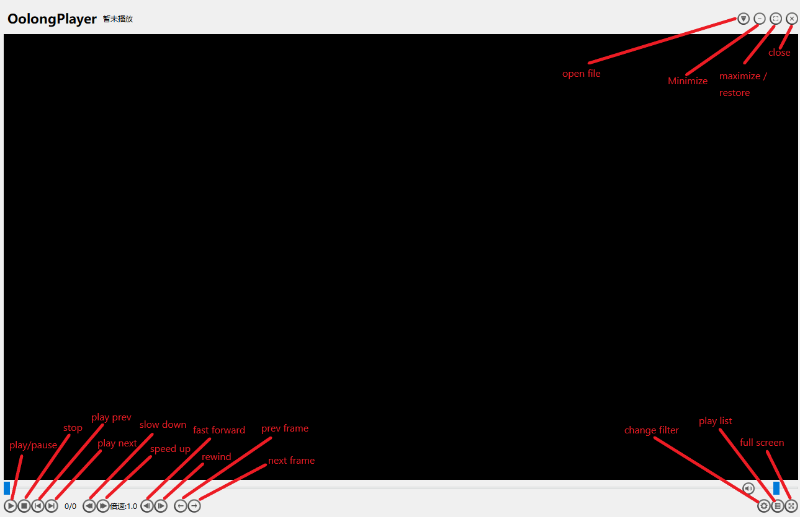

# QtPlayer · 基于 Qt 6 + FFmpeg 的播放器与推流器

> 没用 `QMediaPlayer` 这类成品链路：解封装 / 解码 / 音画同步 / OpenGL 渲染 / 音频输出全部直接基于
> **FFmpeg API** 手写，Qt 只负责界面和窗口。
>
> 仓库里有两个可执行程序和一个内核库：**播放器 `QtPlayer`**、**推流器 `op_pusher`**（mini-OBS）、
> **内核 `op_core`**（静态库，零 Qt 依赖）。

| 项 | 内容 |
|---|---|
| 语言 | C++17 |
| 界面 | Qt 6.11（Widgets / Multimedia / OpenGL / OpenGLWidgets） |
| 媒体 | FFmpeg 8.1（avformat / avcodec / avutil / swresample / swscale / avfilter / avdevice） |
| 渲染 | QOpenGLWidget + GLSL（YUV420P 三平面纹理，零拷贝上传） |
| 构建 | CMake ≥ 3.21 + Ninja；MSVC 2022 验证通过，Ubuntu 24.04 由 CI 构建 |
| 平台 | Windows（主力）、Linux（构建 + 单测跑通，GUI 有已知崩溃）、鸿蒙/安卓在路线图上 |

---

## 目录

- [1. 项目定位](#1-项目定位)
- [2. 构建目标](#2-构建目标)
- [3. 功能特性](#3-功能特性)
- [4. 快速开始](#4-快速开始)
- [5. 架构](#5-架构)
- [6. 目录结构](#6-目录结构)
- [7. 关键常量](#7-关键常量)
- [8. 性能数据](#8-性能数据)
- [9. 已知限制](#9-已知限制)
- [10. 文档与参考](#10-文档与参考)

---

## 1. 项目定位

**本仓库 = Qt 播放器 + 推流器。** 内核 `core/` 已经完成"零 Qt"改造（见下面的分层），
并且已经从源码清单提升为独立的静态库 `op_core`；它接下来会**迁出到单独的仓库做 SDK 化**
（C 接口 + 鸿蒙/安卓移植），本仓库此后只修 bug。

| 本仓库负责 | 不负责（在 SDK 仓库） |
|---|---|
| `app/`：窗口、控制栏、标题栏、播放列表、滑条 | 对外 C 接口（`include/op/op_player.h`） |
| `platform/`：`QAudioSink` 音频输出、`QOpenGLWidget` 渲染目标 | 平台后端（鸿蒙 NAPI / 安卓 JNI） |
| `pusher/`：采集 → 编码 → 封装 → 推流 | 打包成 `.har` / `.aar` 给第三方 |

> 分叉约定、回落流程、迁出清单见 [`docs/CORE-FORK.md`](docs/CORE-FORK.md)。

---

## 2. 构建目标

| 目标 | 类型 | 链接 Qt | 说明 |
|---|---|---|---|
| `op_core` | 静态库 | **否** | 解封装、解码、帧队列、音画同步、消息队列。`AUTOMOC/AUTOUIC/AUTORCC` 全关，编译参数里没有任何 Qt 路径 |
| `QtPlayer` | GUI 可执行 | 是 | 播放器本体：`app/` + `platform/` + `op_core` |
| `op_pusher` | Console 可执行 | **否** | mini-OBS：采集 → H.264/AAC → mp4 / RTMP，零 Qt（dumpbin 里不会出现任何 `Qt6*.dll`） |

`op_core` 是"零 Qt 内核"的**客观证据**，不是靠 grep 说的：它的编译命令里只有源码根目录和 FFmpeg 头。
以后谁不小心往 `core/` 里加了 `Q_OBJECT`，会**直接编不过**，而不是被 moc 悄悄处理掉、再在 Linux/NDK 上炸。

---

## 3. 功能特性



| 分类 | 功能 | 说明 |
|---|---|---|
| 播放 | 播放 / 暂停 / 停止 | 音频用 `QAudioSink`，暂停走 `suspend/resume` |
| 播放 | 进度条 Seek（异步） | UI 不阻塞；seek 请求交给 demux 线程执行 |
| 播放 | 快进 / 快退 5s | 基于当前显示帧 pts |
| 播放 | 倍速 0.5×–2.0× | 音频走 `atempo` 滤镜（不变调），视频同步调整帧间隔 |
| 播放 | 播放列表 | Dock 面板、上下集切换、双击播放 |
| 播放 | 拖拽文件 | 拖入即播放并加入列表 |
| 逐帧 | 下一帧 / 上一帧 | 暂停渲染、解码继续；**上一帧支持无限回退**（历史窗口 + 自动 seek 回填） |
| 画面 | OpenGL YUV 渲染 | YUV420P 三平面纹理 + GLSL，零拷贝上传 |
| 画面 | 像素格式统一 | 解码后统一过 `FrameConverter` 转成 YUV420P，NV12 / 10bit / 全范围片源不会花屏 |
| 画面 | 滤镜 | 原色 / 灰度 / 反色 / 暖色 / 冷色（Shader uniform 切换） |
| 画面 | 全屏 / 无边框窗口 | 双击全屏、Esc 退出；自绘标题栏与边缘缩放 |
| 音频 | 音量调节 | 0–100，静音图标联动 |
| 音频 | 纯音频文件 | 自动黑屏，并**禁用逐帧入口**（没有帧可逐） |
| 网络 | 流媒体播放 | RTSP / RTMP / HTTP 等；`rtsp_transport=tcp` + 中断回调保证能随时退出 |
| 网络 | 流媒体模式降级 | 直播流禁止 seek / 逐帧 / 倍速（进度条与相关按钮整体置灰） |
| 输入 | 键盘快捷键 | 见下表 |
| 推流 | `op_pusher` | 摄像头/麦克风采集 → 编码 → mp4 或 RTMP，带断线重连与统计 |

**快捷键**

| 按键 | 功能 | 按键 | 功能 |
|---|---|---|---|
| `Space` | 播放 / 暂停 | `←` / `→` | 快退 / 快进 5s |
| `F` | 下一帧 | `D` | 上一帧 |
| `↑` / `↓` | 音量 ±5% | `C` / `X` | 升速 / 降速 0.1× |
| `Esc` | 退出全屏 | 双击 | 全屏切换 |

---

## 4. 快速开始

### 4.1 依赖

- **Qt 6**（`Core` `Gui` `Widgets` `Multimedia` `OpenGL` `OpenGLWidgets`）；开发验证版本 6.11.3
- **FFmpeg 8.x** shared build（`include/` + `lib/` + `bin/`），需要 `avformat avcodec avdevice avutil swresample swscale avfilter`
- **CMake ≥ 3.21**、**Ninja**（或任何 CMake 生成器）、MSVC 2022 / GCC 11+

### 4.2 Windows（MSVC）

```bash
# 1) 配置：FFMPEG_PATH 默认是 C:/Program Files/ffmpeg/ffmpeg8.1，装别处就用 -D 覆盖
cmake -S Player/QtPlayer -B build -G Ninja \
      -DCMAKE_BUILD_TYPE=Release \
      -DCMAKE_PREFIX_PATH="C:/Qt/6.11.3/msvc2022_64" \
      -DFFMPEG_PATH="C:/Program Files/ffmpeg/ffmpeg8.1"

# 2) 编译（op_core / QtPlayer / op_pusher 三个目标一起出来）
cmake --build build

# 3) 运行：把 FFmpeg 的 bin 加进 PATH，否则起不来（找不到 avcodec-*.dll）
set PATH=C:\Program Files\ffmpeg\ffmpeg8.1\bin;%PATH%
build\QtPlayer.exe
```

### 4.3 Linux（Ubuntu 24.04，CI 里跑的也是这套）

```bash
sudo apt-get install -y build-essential cmake ninja-build pkg-config \
    qt6-base-dev qt6-multimedia-dev libgl1-mesa-dev \
    libavcodec-dev libavformat-dev libavutil-dev \
    libswresample-dev libswscale-dev libavfilter-dev libavdevice-dev

cmake -S Player/QtPlayer -B build -G Ninja -DCMAKE_BUILD_TYPE=Release
cmake --build build
./build/QtPlayer
```

Linux 分支用 `pkg-config` 找 FFmpeg（`cmake/FFmpeg.cmake` 里按 `if(WIN32)/else()` 分开写），
所以**不需要** `-DFFMPEG_PATH`。GUI 侧在 Linux 上有一个已知崩溃，见 [9. 已知限制](#9-已知限制)。

### 4.4 运行推流器

```bash
# 没有摄像头也能跑：--testsrc 合成视频 + sine 合成音频，直接落盘
build\op_pusher.exe --testsrc --audio-input-format sine -o out.mp4 --duration 10

# 真实设备 → RTMP
build\op_pusher.exe --video "video=USB Camera" -a "audio=麦克风" ^
                    --bitrate 4000000 --gop 60 ^
                    --url rtmp://127.0.0.1/live/demo --reconnect-attempts 10

build\op_pusher.exe --help      # 完整参数
build\op_pusher.exe --list-devices
```

### 4.5 打包绿色版（免安装）

```powershell
# 默认输出 dist\QtPlayer-<版本>-win64\ 并生成同名 zip
.\scripts\build-release.ps1

.\scripts\build-release.ps1 -DryRun                  # 只探测路径与体积，不构建
.\scripts\build-release.ps1 -Version v3.1 -QtDir C:\Qt\6.11.3\msvc2022_64
```

脚本会做：Release 构建 → `windeployqt` 收 Qt 依赖 → 拷 FFmpeg 的 `avcodec-*.dll` 等 →
补 MSVC 运行库 → 打 zip。`dist/` 不入库。

### 4.6 单元测试（默认**不**构建）

`tests/test_framequeue.cpp` 是逐帧状态机的回归测试（headless、不建窗口、不链 Qt）。
本仓库的定位是"播放器 + 推流器，只修 bug"，所以**默认不构建它**；需要时显式打开：

```bash
cmake -S Player/QtPlayer -B build -G Ninja -DOP_BUILD_TESTS=ON
cmake --build build
ctest --test-dir build -C Debug --output-on-failure
```

CI 里是打开的（`.github/workflows/ci.yml`）。等内核迁到 SDK 仓库后，这个测试会跟着过去。

---

## 5. 架构

### 5.1 分层

| 层 | 目录 | 依赖 | 职责 |
|---|---|---|---|
| 内核 | `core/` | 标准库 + FFmpeg（**零 Qt**） | 队列、解封装、解码、渲染节奏、音频解码、同步、消息循环 |
| 平台 | `platform/` | Qt Multimedia / OpenGL | 音频设备（`IAudioOutput` 实现）、渲染目标（`QOpenGLWidget`） |
| 壳 | `app/` | Qt Widgets | 窗口、控件、输入、播放列表 |
| 推送 | `pusher/` | 标准库 + FFmpeg（零 Qt） | 另一条独立链路，与播放器互不依赖 |

### 5.2 线程与消息

```text
              ┌─────────────── app/（GUI 线程）───────────────┐
              │  Player：窗口 / 控件 / 输入 / 播放列表        │
              └───────▲────────────────────────────┬─────────┘
                      │ EVT_*（事件回调，队列投递） │ CMD_*（postMessage）
              ┌───────┴────────────────────────────▼─────────┐
              │ PlayerCore：MessageQueue + 消息循环线程       │
              └───────▲────────────────────────────┬─────────┘
                      │ CTX_*（状态广播，给 UI 展示）│ 指令
   ┌──────────────────┴───────┐        ┌───────────▼──────────────┐
   │ DemuxThread（读包/seek） │        │ AudioThread（解码+输出） │
   └───┬──────────────┬───────┘        └───────────┬──────────────┘
       │ 包队列        │ 包队列                     │
 ┌─────▼─────┐  ┌─────▼──────────┐          ┌──────▼───────┐
 │ 视频解码  │  │ 音频解码       │          │ QAudioSink   │
 └─────┬─────┘  └────────────────┘          └──────────────┘
       │ 帧队列（未来 16 + 历史 48）
 ┌─────▼──────────────┐
 │ VideoRenderThread  │──► paint 回调 ──► GUI 线程（在飞帧数 = 1）
 └────────────────────┘
```

### 5.3 三条硬约定

这三条是 core 化那一轮用血换来的（详见问题文档 24~33），改代码时别破坏：

1. **权威状态放本地，`PlayerContext` 只做单向广播。**
   逐帧/暂停/seek 这些状态的"真值"在改它的那一层（`DemuxThread`、`Player` 自己的成员），
   `PlayerContext` 是发给 UI 看的副本，**慢一个消息往返**，不能拿来做判断。
2. **一次 seek 请求 → 恰好一条 `EVT_SEEK_DONE`。**
   所有 seek 走 `Player::postSeek()` 这一个出口；进度条在落地前"钉住目标"，
   用户连续操作期间 `SEEK_DONE` 不改进度条。
3. **上屏有背压（在飞帧数 = 1）。**
   渲染线程投递给 GUI 线程的帧，GUI 没消化完就**丢**，不排队 —— 否则一拖窗口就攒下几百 MB。

---

## 6. 目录结构

```text
QtFFmpegPlayer/
├── README.md
├── .github/workflows/ci.yml          # Linux：构建 + 无头单测
├── pictures/                         # 界面截图
├── docs/
│   ├── problems-and-solutions.md     # 踩过的坑（现象→根因→解决），含 core 化 24~33
│   ├── player-pusher-notes.md        # 推流器设计笔记（Q/A 形式）
│   └── CORE-FORK.md                  # core 迁出 / SDK 化 的分叉约定
├── scripts/build-release.ps1         # 一键打包免安装绿色版
├── testData/                         # 性能测试的原始采样记录
├── dist/                             # 打包输出（不入库）
└── Player/QtPlayer/
    ├── CMakeLists.txt
    ├── CMakePresets.json
    ├── cmake/FFmpeg.cmake            # ffmpeg_deps INTERFACE 目标（Win: 路径 / Linux: pkg-config）
    ├── include/op/op_player.h        # SDK 的 C 接口草案（本仓库不编译，只是设计稿）
    ├── core/                         # ── 内核：零 Qt ──
    │   ├── framequeue.{h,cpp}        #   未来帧环 + 历史窗口（逐帧核心）
    │   ├── packetqueue.{h,cpp}       #   有界包队列（超时投递 / abort）
    │   ├── demuxthread.{h,cpp}       #   读包、异步 seek、逐帧回填
    │   ├── decodethread.{h,cpp}      #   解码基类：send/recv、解码器生命周期
    │   ├── videodecodethread.{h,cpp} #   视频解码 + 像素格式统一
    │   ├── videorenderthread.{h,cpp} #   帧消费、节奏、同步、丢帧、逐帧步进
    │   ├── audiothread.{h,cpp}       #   音频解码 + atempo 倍速 + 音频时钟
    │   ├── frameconverter.{h,cpp}    #   swscale 统一成 YUV420P（加锁，跨线程共用）
    │   ├── messagequeue.{h,cpp}      #   消息队列
    │   ├── messageloopthread.{h,cpp} #   消息循环线程
    │   ├── playercore.{h,cpp}        #   入口：postMessage / 事件回调 / start-stop
    │   ├── playercontext.h           #   状态广播（只读给 UI）
    │   ├── iaudiooutput.h            #   音频出口接口（platform 实现）
    │   ├── log.h / perfclock.h       #   日志 / 纳秒时钟
    ├── platform/
    │   ├── audioplayer.{h,cpp}       #   QAudioSink 实现 IAudioOutput
    │   └── videowidget.{h,cpp}       #   QOpenGLWidget：YUV 渲染 + 滤镜 + 丢帧邮箱
    ├── app/
    │   ├── main.cpp                  #   timeBeginPeriod(1) 等进程级初始化
    │   ├── player.{h,cpp,ui}         #   主窗口：状态机、seek 收口、输入、全屏
    │   ├── ctrlbar.{h,cpp,ui}        #   底部控制栏
    │   ├── topmenu.{h,cpp,ui}        #   顶部标题栏
    │   ├── playlist.{h,cpp,ui}       #   播放列表
    │   └── myslider.{h,cpp}          #   支持点击跳转的进度条
    ├── pusher/                       # op_pusher：采集 → 编码 → 封装 → 推流
    └── tests/test_framequeue.cpp     # 逐帧状态机单测（默认不构建）
```

---

## 7. 关键常量

| 常量 | 值 | 位置 | 含义 |
|---|---|---|---|
| `FrameQueue::MAX_QUEUE_SIZE` | 16 | `core/framequeue.h` | 未来帧队列容量（背压上限） |
| `FrameQueue::MAX_HISTORY_SIZE` | 48 | `core/framequeue.h` | 历史帧容量（能连续回退多少帧） |
| `kRefillKeepFrames` | 16 | `core/videodecodethread.cpp` | 单次回填保留的帧数 |
| `PUSH_TIMEOUT_MS` | 10 | `core/demuxthread.cpp` | 包投递超时（决定控制响应性） |
| `SYNC_THRESHOLD` | 30 | `core/videorenderthread.cpp` | 音画同步阈值（ms） |
| 回填跨度 | `(MAX_HISTORY_SIZE/2)·1000/fps`，夹在 `[500,5000]` ms | `core/demuxthread.cpp` | 回填时向后 seek 多远 |
| `kSeekUiHoldMs` | 1500 | `app/player.cpp` | 进度条"钉住目标"的最长时间 |
| `kSeekLockTimeoutMs` | 2000 | `app/player.cpp` | `SEEK_DONE` 丢失时的解锁兜底 |

**内存账**：1080p 8bit YUV420P 单帧 ≈ 3.11 MB；未来 16 + 历史 48 = 64 帧 ≈ **200 MB**。
历史深度就是"内存 ↔ 后退距离"的取舍，改 `MAX_HISTORY_SIZE` 就能换。

---

## 8. 性能数据

> **这批数据是 core 化之前在同一台机器上测的**，core 化后没有重跑（线程壳、消息循环、像素格式链路都换了，
> 数值可能略有出入）。原始采样记录仍在 [`testData/`](testData/)，与各表一一对应，方便复核。

### 8.1 测试环境

| 项目 | 配置 |
|---|---|
| CPU | R9 5900x |
| GPU / 驱动 | 6750GRE 12G |
| 内存 / 存储 | 16GB DDR4 4000 双通道 |
| 操作系统 | Windows 10 22H2 x64 |
| Qt / FFmpeg | Qt 6.11 / FFmpeg 8.1（shared build） |
| 构建 | MSVC 2022，Release，`/O2 /MD` |
| 测试片源 | ① 1080p60 H.264 8Mbps（GOP≈2s，B 帧=3）② 4K60 HEVC ③ 720p60 H.264 ④ 纯音频（MP3/FLAC） |
| 采样工具 | 任务管理器 / `typeperf` / `Get-Process` / 代码内打点日志 |

**测试条件与局限**

- **延迟口径**：除「回填耗时」是代码内部打点（`doBackwardRefill()` 自身耗时）外，其余延迟类指标都是
  **端到端**——从界面按下按钮 / 拖动进度条开始计时，到画面真正更新为止，更贴近用户实际感受。
- **跨指标可比性**：各指标来自不同采样轮次，并非同一次运行，跨行比较只能作粗略参考。
- **内存有三种口径，跨表不要直接比**：§8.2「常驻内存（1080p）」是 1080p60 播放 60s 期间的
  **私有内存峰值**；§8.5 是按 `MAX_HISTORY_SIZE` 三档各自单独运行测得的总量；
  §8.4 的 270 → 264 MB 是同一配置下去掉 `datas[]` 缓冲前后的对比。
- **4K 项已换片源重测**：早期一轮的片源分辨率与命名不符，重测后 4K60 为 **163.91%** vs
  1080p60 **126.43%**（每帧 2.73 vs 2.11 %/帧，约 1.3×）。
- **显示器分辨率与本项无关**：解码始终按码流原始分辨率进行，1080p 屏只影响 GPU 侧的缩放与合成。
- **采样环境**：本机 12 核，未做 CPU 亲和绑定，也未清空后台程序；多核下 CPU% 可以超过 100%
  （100% = 占满一颗核）。

### 8.2 播放指标

| 指标 | 我怎么测 | 自定目标 | 实测 |
|---|---|---|---|
| 首帧时间 | `playFile()` 入口打点 → 第一帧真正上屏。**含打开文件 + 建线程 + 首次解码** | 80 ~ 250 ms | 121.4ms~200ms |
| 平均 CPU（1080p60） | 稳定播放后 `typeperf "\Process(QtPlayer)\% Processor Time"`（多核可 >100%） | < 200%（12 核） | 126.43% |
| 峰值 CPU（4K60） | 同上 | < 200%（12 核） | 187.49%（均值 163.91） |
| 常驻内存（1080p） | 稳定后 60s 私有工作集峰值 | < 800 MB | 683.0 MB（未播放基线 343.9 MB） |
| 常驻内存（4K60） | 同上 | < 2000 MB | 1503.0 MB |
| 长播内存曲线（2h） | 每 5min 采样一次私有工作集，看是否单调增长 | 无增长趋势 | 无单调增长：734.2 → 744.0 MB（后 60min +1.0 MB） |
| 屏幕渲染 FPS | `paintGL` 每秒统计：正常播放 / 拖动窗口 | ≥ 片源帧率 | 正常 60.06；拖动 40.35（最低 12.39） |
| 丢帧率 | 渲染线程"落后音频丢帧"分支加计数器，5min | < 1% | 0%（36016 帧丢 0 帧） |
| 音画偏差 | 每秒采样 `videoPts - audioPts` | `\|diff\| < 50ms` | 均值 23.5 ms、最大 44 ms |

### 8.3 交互与逐帧指标

| 指标 | 我怎么测 | 自定目标 | 实测 |
|---|---|---|---|
| Seek 延迟 P50 / P95 | 端到端：发起 seek → 目标帧上屏，随机 50 次 | P95 < 300 ms | P50 8.8 ms / P95 161.8 ms |
| 下一帧步进耗时 | 端到端：按 `F` → 帧上屏 | < 30 ms | 均值 3.8 ms（2.4 ~ 5.3） |
| 上一帧步进耗时（命中历史） | 端到端：按 `D` → 帧上屏，不触发回填 | < 30 ms | 均值 3.2 ms（1.5 ~ 5.8） |
| 回填耗时 | 内部打点 `doBackwardRefill()`（**非端到端**） | < 300 ms | P50 109.3 ms / P95 164.8 ms |
| 上一帧端到端（首次跨边界） | 端到端：按 `D` → 画面更新（含等待回填） | < 200 ms | 均值 80.1 ms（57.4 ~ 112.1） |

### 8.4 优化前后对比

| 场景 / 指标 | 优化前 | 优化后 | 对应改动 |
|---|---|---|---|
| 常驻内存 | 270 MB | 264 MB | 去掉 `setPaint` 每帧 3MB 的 memcpy |
| 拖动窗口时的渲染 FPS | 未单独记录 | 均值 40.35，最低 12.39（正常 60.06） | 丢帧邮箱（在飞帧数 = 1） |
| 松手后画面"追帧" | 会把积压的帧补播一遍 | 无 | 同上 |
| 逐帧回退定位准确性 | 偏几帧 / seek 目标错误 | 帧级精确 | 完整解码定位 + 毫秒坐标系统一 |
| 长时间连续 seek 稳定性 | 偶发卡死 | 无卡死 | 控制线程非阻塞投递 + 背压环看门狗 |

### 8.5 配置取舍（历史深度 ↔ 内存 / 可回退距离）

> 估算公式：`内存 ≈ (16 + MAX_HISTORY_SIZE) × 单帧大小`。
> 末列是三档**各自单独运行**测得的总量，与 §8.2 的 683 MB 不是同一次采样。

| 配置 | `MAX_HISTORY_SIZE` | 内存上限（估算） | 连续可回退 | 实测内存 |
|---|---|---|---|---|
| 省内存 | 16 | ≈ 100 MB | 16 帧 | 540 MB |
| 默认 | 48 | ≈ 200 MB | 48 帧 | 634 MB |
| 深度回退 | 96 | ≈ 350 MB | 96 帧 | 781 MB |

### 8.6 原始测试数据

| 目录 | 对应指标 | 内容 |
|---|---|---|
| `平均CPU 1080p60 12核 60s/`、`平均CPU  4K60 12核 60s/` | 8.2 CPU | `typeperf` 逐秒采样 |
| `内存占用 1080p60  60s/`、`内存占用  4K60  60s/`、`常驻内存 1080未播放/` | 8.2 内存 | `Get-Process` 逐秒私有工作集 |
| `长播内存曲线（2h）/` | 8.2 长播 | `mem_2h.csv` + 可读版 + 采集脚本 |
| `屏幕真实渲染FPS 1080p60/` | 8.2 渲染 FPS | 正常播放 / 拖动窗口 |
| `丢帧率5mins/` | 8.2 丢帧率 | 周期打印的 shown / lose frames |
| `音画偏差/` | 8.2 音画偏差 | 每帧 `videoPts` / `audioPts` / `diff` |
| `交互与逐帧指标/` | 8.3 | seek / 逐帧 / 回填的 `[PERF]` 打点日志 |

---

## 9. 已知限制

1. **还是软解**：硬件解码（D3D11VA / MediaCodec）没接，高码率 4K 下 CPU 占用偏高；
2. **时间轴原点**：进度条用"帧 pts / 容器 duration"，没用 `AVStream::start_time` 归一化，
   某些起点不为 0 的流（部分 TS）会有固定显示偏移；
3. **VFR（可变帧率）**：回填跨度按 `avg_frame_rate` 估，VFR 下不够准（可用 `AVFrame::duration` 改进）；
4. **字幕 / HDR 都没做**：字幕轨、10bit/HDR、色彩空间（BT.601/709、limited/full range）都没处理；
   目前像素格式统一到 YUV420P，10bit 会被降位；
5. **Linux 有一个已知崩溃**：打开文件后崩在 QtMultimedia 音频端点（见问题文档第 23 条），
   结论是等 `platform/` 换成自己的音频后端再看；Linux 侧性能数据也未采集；
6. **内核要迁出**：`core/` 之后会移到 SDK 仓库，本仓库只保留一份拷贝用于回落 ——
   见 [`docs/CORE-FORK.md`](docs/CORE-FORK.md)；
7. **单测默认不构建**：本仓库只修 bug，`OP_BUILD_TESTS` 默认 OFF（CI 里打开）。

---

## 10. 文档与参考

- [开发问题与解决方案](docs/problems-and-solutions.md)：真实踩到的问题（现象 → 排查 → 根因 → 解决），
  第 24~33 条是 core 化那一轮的坑（线程壳、异步广播、消息所有权、时钟分辨率、seek 串行化、像素格式）
- [推流器设计笔记](docs/player-pusher-notes.md)：`op_pusher` 的取舍与问答
- [Core 迁出 / SDK 化](docs/CORE-FORK.md)：分叉约定、回落流程、C 接口草案说明
- FFmpeg 官方文档：`avformat` / `avcodec` / `avutil`（时间基、`av_seek_frame`、`AVFrame` 引用计数）
- ffplay（FFmpeg 自带参考播放器）：`frame_queue` 的环形预分配与 `keep_last` 设计
- mpv issue #4019：关于"逐帧后退为什么慢、以及缓存策略的取舍"
- GStreamer 设计文档 *Frame stepping*：步进事件与"后退需要 seek"的框架级约束
